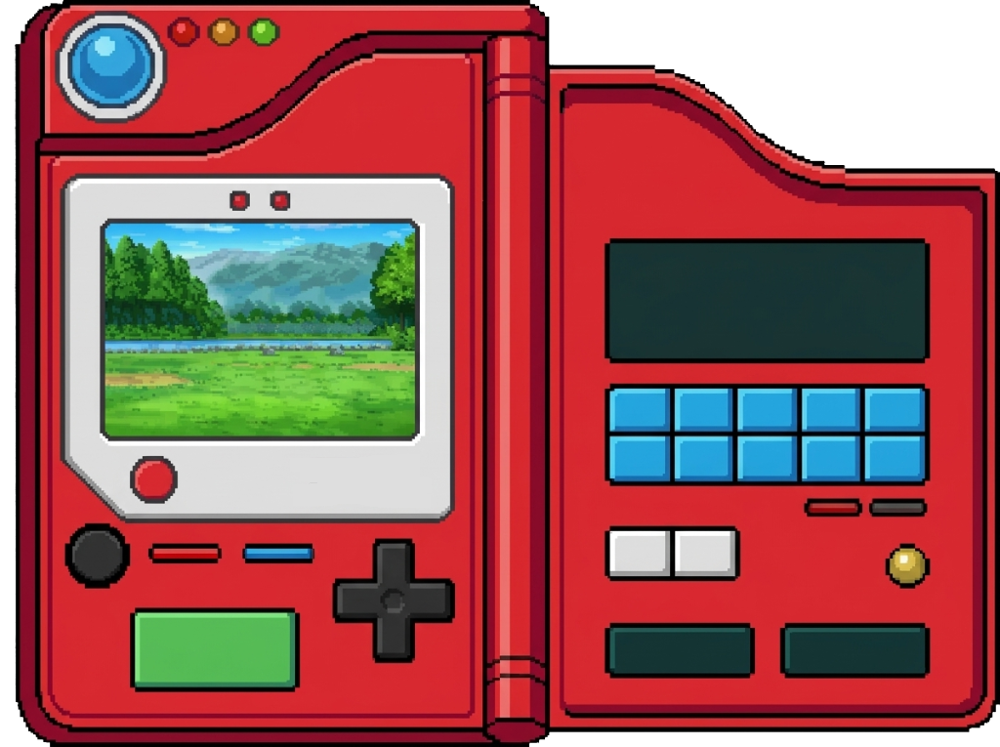

# 🔴 Pokédex Clássica Interativa

Uma Pokédex interativa, nostálgica e responsiva construída com **HTML5, CSS3 e JavaScript puro**, consumindo dados em tempo real da [PokéAPI](https://pokeapi.co/).

O projeto foi desenvolvido para recriar a verdadeira experiência dos jogos clássicos de Pokémon (Geração 5 - *Black & White*), unindo estética *pixel art*, sons retrô e funcionalidades interativas.

---




---

## ✨ Funcionalidades

- 🔍 **Busca Dinâmica:** Pesquise instantaneamente qualquer Pokémon pelo seu **Nome** ou pelo seu **Número (ID)**.
- ⬅️ ➡️ **Navegação Rápida:** Botões `Prev <` e `> Next` para percorrer os Pokémon de forma sequencial.
- 🎬 **Sprites Animados:** Exibição dos GIFs animados originais de batalha da Geração 5 (*Black & White*).
- 🔊 **Gritos dos Pokémon (*Cries*):** Reprodução automática do som original de cada Pokémon via Audio API ao ser carregado.
- 🏷️ **Tipagem Visual Oficial:** Renderização dinâmica das insígnias/plaquinhas de tipos (Fogo, Água, Grama, Fada, etc.).
- ❓ **Modo Quiz ("Quem é esse Pokémon?"):**
  - Desafie seus conhecimentos Pokémon com o modo silhueta.
  - Ao clicar no botão de Quiz, um Pokémon aleatório aparece como sombra tocando seu som clássico para você adivinhar o nome!
- 📱 **Design Responsivo:** Layout adaptado com CSS Grid e Flexbox que se ajusta perfeitamente em telas de desktop e dispositivos móveis.

---

## 🛠️ Tecnologias Utilizadas

- **HTML5:** Estrutura semântica para interface.
- **CSS3:** Estilização nostálgica, layout responsivo e classes para efeito de sombra/silhueta do Quiz.
- **JavaScript (ES6+):**
  - Requisições assíncronas com `Fetch API` e `Async/Await`.
  - Manipulação dinâmica do DOM.
  - Controle de áudio nativo (`Audio API`).
- **[PokéAPI](https://pokeapi.co/):** API pública com dados, sprites e áudios oficiais da franquia Pokémon.

---

## Como Executar o Projeto

Como o projeto foi desenvolvido com tecnologias web nativas (vanilla), você não precisa instalar nenhuma dependência ou gerenciador de pacotes:

1. **Clone o repositório:**
   ```bash
   git clone https://github.com/gustavorubinho/Pokedex.git
   ```

2. **Acesse a pasta do projeto:**
   ```bash
   cd Pokedex
   ```

3. **Abra o arquivo `index.html`:**
   - Dê um duplo clique no arquivo `index.html` no seu gerenciador de arquivos; **OU**
   - Utilize a extensão **Live Server** no VS Code para abrir com *hot-reload*.

---

## 📁 Estrutura de Arquivos

```text
Pokedex/
├── css/
│   └── style.css            # Estilos gerais, fontes e responsividade
├── favicons/
│   └── Icon.png             # Ícone do projeto
├── img/
│   ├── pokedex_left.png     # Carcaça esquerda da Pokédex
│   ├── pokedex_right.png    # Carcaça direita da Pokédex
│   └── pokedex_pixel_art.png# Arte completa para preview
├── js/
│   └── script.js            # Lógica de busca, consumo da PokeAPI e Modo Quiz
├── index.html               # Estrutura principal da página
└── README.md                # Documentação do projeto
```

---

## 👨‍💻 Autor

Desenvolvido por **[Gustavo Felipe (Rubinho)](https://github.com/gustavorubinho)**.

Se gostou deste projeto, sinta-se à vontade para deixar uma ⭐ no repositório!
